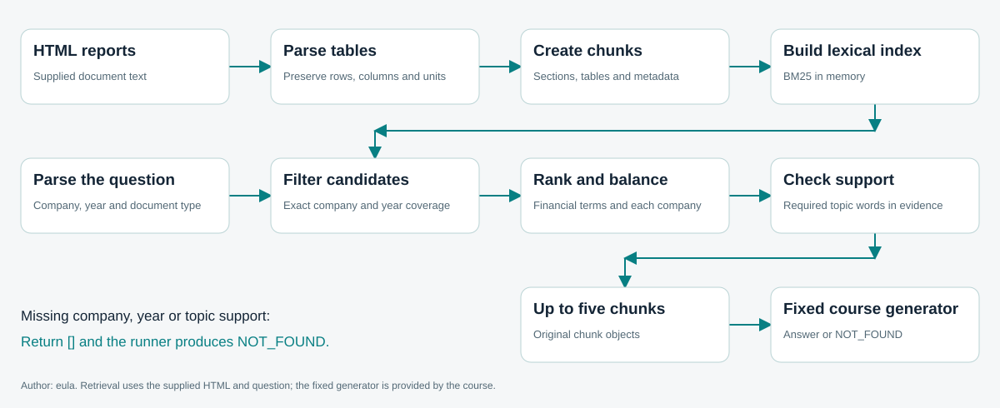

# FTEC5660 Homework 4

Author: eula

Student: SANG Yuchen

Student ID: 1155262204

The implementation supplies the five required functions in hw4.py. The final V6 configuration answered all 60 public questions correctly and received 75/75 estimated automatic points from the provided runner, with a second check on the final source from a fresh local clone. The private set and the 25 points assessed by the TAs remain outside these measured results.

## Install and run

Use Python 3.10 or newer; the recorded environment is Python 3.12.12. From this repository's root, create an environment with `python -m venv .venv`, then activate it with `.\.venv\Scripts\Activate.ps1` on Windows or `source .venv/bin/activate` on macOS/Linux.

```text
python -m pip install -r requirements.txt
```

Copy .env.example to .env and set your own DEEPSEEK_API_KEY locally. The course runner uses deepseek-v4-flash through the original client. The Python 3.12 package versions used in the experiments are recorded separately in requirements-lock.txt.

```text
python hw4.py --data-folder public_test
```

This command builds the index from the supplied HTML, uses V6 by default, and writes results.csv. The index exists in memory during a run. The .env file, environment directory and local caches are ignored by Git. The submitted results.csv is the byte-for-byte copy of the measured V6 output in experiments/V6/results.csv.

```text
python -m unittest test_hw4 -v
python check_offline.py --variant V6 --output .cache/offline.json
```

Both checks above use zero model calls. To reproduce every ablation in new folders while preserving the supplied measurements:

```text
python experiments.py --all --output-root .cache/reproduction
```

To measure one configuration, use `python experiments.py --variant V3 --out .cache/my_V3_run`. Existing completed run folders are preserved. Each measured run uses the original course runner, generator and scorers, with observation wrappers saving the selected context and progress. Every generator call uses the provided course client.

## Homework 4 solution

### Pipeline and design



The parser reads the document heading to identify its company, report year and document type, and it converts tables into lines that retain their caption, row label, column label and printed values. Section and table boundaries guide chunks of at most 1,500 characters, while short headers preserve the company, document year and section within the searchable text. Company and broker catalogues come from the supplied HTML. The question parser identifies requested companies, including unfamiliar names, the requested year and document type. Candidate filtering uses the year coverage of each document, so a previous-year annual figure or a future estimate can come from a report with a different fiscal year. BM25 then ranks canonical financial words after query scaffolding and already-filtered entity/date terms are removed. Comparison retrieval allocates results across each requested company, and a lexical support check returns an empty list when required topic words lack support in the eligible documents. The final result contains up to five original chunk objects for the fixed generator.

### Controlled cumulative comparison

The eight rows use the same 40 documents and 60 public questions, the same fixed generator, temperature 0, thinking disabled, a 64-token output limit, and the original eight-worker runner. Each row adds one component. B0 uses BeautifulSoup get_text, RecursiveCharacterTextSplitter with chunk_size 1200 and chunk_overlap 160, the required metadata, whitespace-token BM25 top five over the whole corpus, an empty question parser and a policy that always retrieves chunks. All retrieval components use zero model calls. The financial normalizer is one text preprocessing component, covering word forms, financial synonyms and removal of query scaffolding after metadata filtering.

| Version | One change from the previous row | Correct / 60 | Accuracy | Recall@5 | Query fields | Kept | Rejected |
|---|---|---:|---:|---:|---:|---:|---:|
| B0 | Required naive baseline | 32/60 | 53.3% | 37.0% | 0.0% | 100.0% | 0.0% |
| V1 | Add table row, column and unit text | 23/60 | 38.3% | 19.6% | 0.0% | 100.0% | 0.0% |
| V2a | Add section and table aware chunk boundaries | 26/60 | 43.3% | 28.3% | 0.0% | 100.0% | 0.0% |
| V2 | Add contextual headers to the same chunks | 51/60 | 85.0% | 80.4% | 0.0% | 100.0% | 0.0% |
| V3 | Add question parsing and metadata filtering | 56/60 | 93.3% | 91.3% | 100.0% | 100.0% | 71.4% |
| V4 | Add the financial lexical normalizer | 60/60 | 100.0% | 100.0% | 100.0% | 100.0% | 71.4% |
| V5 | Add balanced retrieval for comparisons | 60/60 | 100.0% | 100.0% | 100.0% | 100.0% | 71.4% |
| V6 | Add the evidence support check | 60/60 | 100.0% | 100.0% | 100.0% | 100.0% | 100.0% |

Recall@5 uses the 46 answerable questions and requires every needed fact, including both companies in a comparison. Query fields measure the three fields checked by the course scorer. Kept is the share of answerable questions receiving chunks; rejected is the share of the 14 unanswerable questions receiving an empty list. The reported answer accuracy uses all 60 questions.

The first seven rows were measured before adding the isolating V2a branch. During review, section boundaries and contextual headers were separated so that each row changes one component. V2a uses the same boundaries as V2 while omitting its contextual metadata header. The new source was checked against all 420 earlier question contexts and parsed outputs, which matched exactly; the fixed generator section also remains unchanged. The additional V2a run and both original and final fresh-clone checks are retained. Details are in experiment_plan.json and report/context_equivalence.json.

### Resource measurements

| Version | Chunks | Generator calls | Input tokens | Output tokens | Estimated USD | Wall seconds |
|---|---:|---:|---:|---:|---:|---:|
| B0 | 293 | 60 | 101,900 | 184 | 0.0154 | 7.41 |
| V1 | 360 | 60 | 95,500 | 181 | 0.0144 | 7.21 |
| V2a | 865 | 60 | 57,101 | 184 | 0.0087 | 7.69 |
| V2 | 865 | 60 | 70,776 | 203 | 0.0107 | 7.87 |
| V3 | 865 | 50 | 58,910 | 173 | 0.0089 | 6.87 |
| V4 | 865 | 50 | 65,992 | 170 | 0.0100 | 7.14 |
| V5 | 865 | 50 | 65,673 | 174 | 0.0100 | 6.92 |
| V6 | 865 | 46 | 61,194 | 163 | 0.0093 | 6.83 |

All runs finished well within the 30-minute limit. Wall time includes module initialization and the wrapped course run, while the individual run logs also retain the runner's stage timings. Input use fell by 39.9% between B0 and V6. The USD values use the course price constants and represent estimates; the provider's actual billing can differ. Each configuration was measured once at temperature zero, so these times are descriptive and hosted-model variability remains a limitation. The eight primary rows used 436 generator calls, and the complete work including two fresh-clone checks and the API smoke used 529 paid calls with an estimated course-price cost of USD 0.1060.

### Analysis of each change

1. Table conversion in V1 reduced accuracy from 53.3% to 38.3% and recall from 37.0% to 19.6%. Expanding rows with labels and years changed the fixed splitter's boundaries and BM25 token statistics while the baseline still used unfiltered whitespace queries. Preserving table structure alone therefore provided limited benefit within that naive ranking configuration.
2. Section and table boundaries in V2a raised accuracy to 43.3% and recall to 28.3%, while many table chunks still lacked searchable company identity. Adding the short contextual header in V2 raised these to 85.0% and 80.4% with exactly the same chunk boundaries, showing the importance of retaining identity and section information in lexical search.
3. V3 reached 93.3% accuracy and 91.3% recall after filtering companies, document types and covered years. The same component rejected the five unsupported company questions and five unsupported year questions, giving 71.4% rejection of unanswerable questions.
4. V4 recovered the remaining four answerable evidence misses through the financial lexical normalizer, reaching 100% recall and accuracy. Focusing the query on the financial subject reduced interference from repeated company names, dates and question wording.
5. V5 retained 100% accuracy and recall. Balanced comparison allocation produced no marginal score gain on this public sample, where V4 already retrieved every required comparison fact. It remains a structural coverage safeguard, supported by the separate comparison test.
6. V6 retained 100% answer accuracy and increased retrieval rejection to 100%. V5's fixed generator already answered NOT_FOUND on the remaining undisclosed figures even though retrieval returned chunks; V6 made that decision earlier, removed four unnecessary generator calls and raised Task 3 from 7.14/10 to 10/10.

### Error analysis

- In q003, the B0 employee comparison was correct, while V1 returned only Payments-related sources and produced NOT_FOUND. Its missing Robotics evidence illustrates why a comparison needs coverage of both companies. Later versions recover the necessary facts, and the final balanced allocation explicitly reserves space for each company.
- In q016, V3 retrieved the correct company document but answered 1724.5 for FY2024 gross profit. V4 answered the correct 1805.4 after retrieving the needed fact with the financial query. Correct file selection alone therefore leaves a risk of missing or confusing a row or year within that file.
- In q054, V3 returned chunks from the correct company report while missing the printed inventory fact. Its answer was NOT_FOUND. V4 retrieved that fact and answered 297.4, demonstrating the benefit of topic-focused lexical matching within the filtered company documents.
- The four undisclosed topics still received chunks in V5, and the fixed generator correctly refused their answers. V6 rejected them at retrieval time. This separates answer accuracy from the abstention score and explains why both measures appear in the table.

The complete changes in correctness, evidence hits and refusal decisions are in report/error_analysis.csv, with per-question chunk text and metadata in every retrieval_trace.jsonl. The final V6 output has no public question errors.

### Final checks and limits

| Question category | Correct / questions | Accuracy |
|---|---:|---:|
| comparison | 12/12 | 100.0% |
| fact | 12/12 | 100.0% |
| table | 22/22 | 100.0% |
| unanswerable | 14/14 | 100.0% |

All 12 public table tests preserve their labelled cells and captions, and all 40 public documents pass metadata and content coverage checks. The longest final chunk is 1,499 characters. Ten synthetic tests use other company names and years to check multi-level table headers, possessives, similar names, document-year coverage, comparison allocation, unknown subjects, chunk identity and the isolated header comparison. The final source also completed the original end-to-end runner from a fresh clone with an externally supplied key, obtaining 60/60 correct and 75/75 estimated automatic points.

The inference functions derive their inputs from the document HTML and question. Public answer files are used by the provided scorer and evaluation tools. The provided generator, loaders and scoring code remain unchanged below the required boundary, and evidence hashes are supplied in report/evidence_sha256.json. Index data is rebuilt for each supplied corpus and remains in memory.

The public labels informed development, and this sample provides development results with a ceiling at V4. The hidden companies and private scores remain unobserved. Proper-name patterns, word-form aliases and exact topic-word support can miss unfamiliar phrasing or casing, and incidental mentions can satisfy lexical support without establishing that a financial figure is disclosed. A future extension could evaluate paraphrase cases separately and use the permitted model for targeted evidence checks, while keeping the original source chunks and measuring any extra cost. One run per variant also limits conclusions about model variability and timing.

### Evidence files

- report/ablation.csv contains the tabulated measurements.
- experiments/B0 through experiments/V6, including V2a, contain original results.csv, run.log, summary.json and retrieval_trace.jsonl.
- experiments/fresh_clone and experiments/final_fresh_clone retain two end-to-end checks.
- report/context_equivalence.json records the 420-context verification after introducing V2a.
- report/usage_accounting.json includes all paid calls, including the smoke and clone checks.
- requirements-lock.txt records the Python 3.12 environment, and experiment_plan.json records the cumulative design and its revision.

## Reflection

The Task 6 reflection is available as [REFLECTION.pdf](REFLECTION.pdf), with the editable text in [REFLECTION.md](REFLECTION.md). Four connected paragraphs use the Homework 4 experiments, evidence checks and comparison results to consider future ambitions, responsibility, chosen effort, identity and practical habits. Selected experiences from finance study, securities automation, consulting, procurement, research and creative activities connect the assignment to personal goals. AI assistance is disclosed as allowed by the handout, and the original CV stays outside this repository.

## Submission

The handout requires a public fork named FTEC5660-HW4 and its URL on Blackboard by 1 December at 23:59 HKT. Keep the repository public during grading and supply the code, requirements, experiment scripts, this report and the reflection. Local credentials and binary index files are excluded from Git, and the grader supplies its own key.

The source assignment is [hz0567/FTEC5660-HW4](https://github.com/hz0567/FTEC5660-HW4), originally downloaded at commit 89141195ffc63004dec6e8cac1d6ad19e7c862a4. The implementation and measured analysis are by eula for SANG Yuchen, 1155262204.
